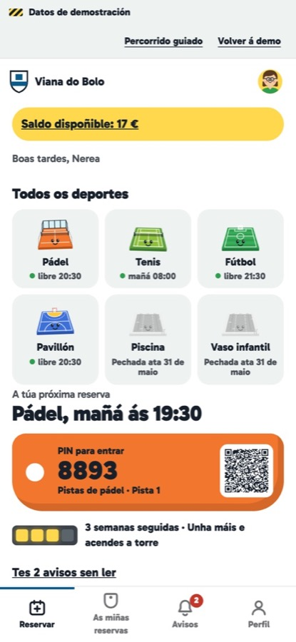
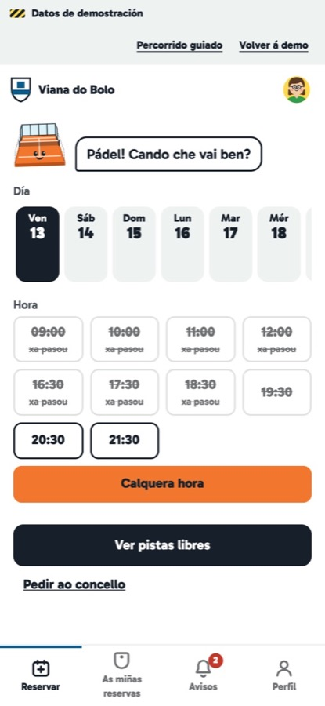
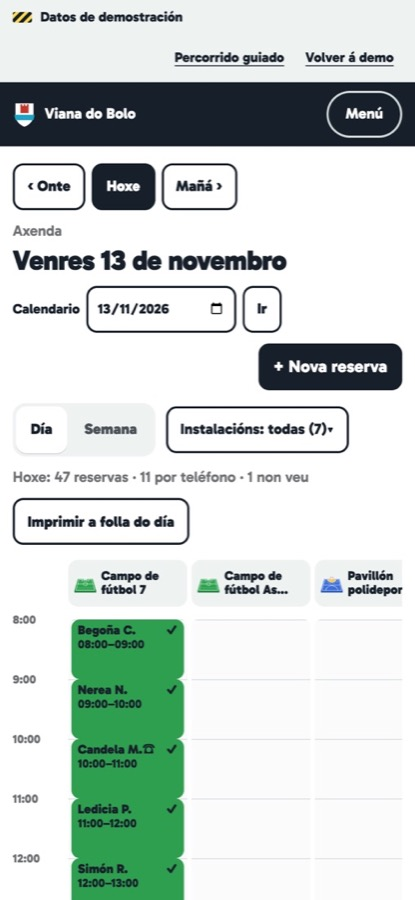
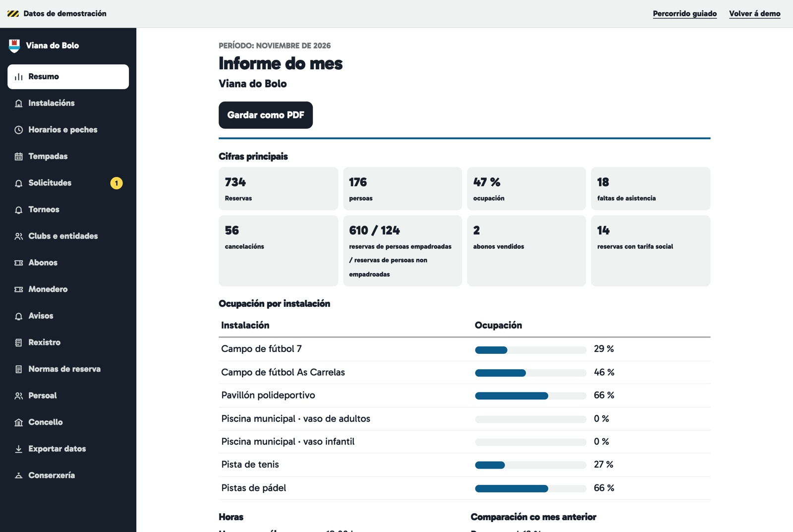

# Xogamos

**Plataforma libre de reservas deportivas para concellos.** A veciñanza reserva desde o móbil e
entra cun PIN ou un QR; o concello xestiona instalacións, normas, clubs e tempadas e segue o uso
con indicadores; a Deputación pode aloxar nunha soa instalación todos os concellos pequenos.

Proposta ao **I Certame GOBTEC de Software Libre** (AGASOL, 2026). Licenza **EUPL-1.2**.

**Demo:** https://187-33-145-223.sslip.io · **Documentación:** [docs/](docs) · **Cumprimento das bases:** [docs/cumprimento.md](docs/cumprimento.md)

<table>
  <tr>
    <td align="center" width="25%"><br><sub>Inicio da veciñanza</sub></td>
    <td align="center" width="25%"><br><sub>Escoller día e hora</sub></td>
    <td align="center" width="25%"><br><sub>Reserva con PIN e QR</sub></td>
    <td align="center" width="25%"><br><sub>Axenda da conserxería</sub></td>
  </tr>
</table>

<p align="center"><br><sub>Informe do mes do concello (datos ficticios)</sub></p>

## Por que Xogamos

Naceu dunha conversa co Concello de Viana do Bolo (~2.700 hab.): as reservas fanse en papel na
xanela e, no inverno, para xogar ao pádel hai que chamar á Policía Local para que abra. Por iso,
ademais de reservar, a plataforma dixitaliza o traballo dun concello pequeno:

- **Papel «Apertura»:** quen abre a instalación recibe un aviso e valida o PIN ou o QR. Ninguén ten que chamar.
- **Solicitudes en liña** de horas fixas de tempada e eventos, que substitúen o papel.
- **Clubs** con condicións propias e **tempadas** de outubro a xuño.
- **Tarifas** de empadroados e tarifa social, **monedeiro** con tarxetas de recarga, **bonos e abonos**.
- **Conserxería** que reserva por teléfono ou en persoa para quen non usa internet.
- **Identidade só pública** (Cl@ve e Chave365): sen contrasinais propios nin contas de terceiros.
- **Lista de espera:** se unha hora está chea, avísase cando quede libre e gárdase a praza media hora.
- **Datos abertos e portables:** catálogo DCAT-AP-ES, GeoJSON das instalacións, schema.org, API OpenAPI con documentación lexible en `/api/docs` e importación da configuración dun concello.
- **Accesibilidade comprobada en cada cambio:** axe-core en 48 pantallas, en escritorio e a 320 px.
- **Sen IA e sen enviar datos a terceiros.**
- Páxinas que se renderizan no servidor e funcionan sen JavaScript e sen conexión estable.

## Viana en 4 minutos

1. Abre `/demo` e entra como **Nerea** (veciña). Reserva pádel, mira o PIN e o QR.
2. Volve a `/demo` e entra como **Baltasar** (conserxería): axenda do día, validar o PIN de Nerea, reserva por teléfono buscando un DNI ficticio.
3. Entra como **Amalia** (administración): solicitudes pendentes, horarios e peches, informe do mes.
4. Entra como **Celia** (Deputación): comparativa dos 11 concellos e alta dun concello novo.

Cada papel ten un **percorrido guiado** que se pode activar desde a barra da demo.

Pila: SvelteKit (Svelte 5, TypeScript estrito), Node 22 (`.nvmrc`), PostgreSQL 17 e Drizzle ORM.

## Instalación

Nun servidor con Docker, instale cun só comando:

```sh
git clone https://github.com/isaay6/xogamos.git xogamos && cd xogamos
./install.sh
```

Para opcións de demo, instalación local e operación, consulte a guía de
[instalación](docs/instalacion.md).

## Documentación

- [Instalación](docs/instalacion.md): Docker, copias e proxy HTTPS.
- [Guía de uso](docs/guia-de-uso.md): unha páxina por papel.
- [Arquitectura e decisións](docs/arquitectura.md).
- [Interoperabilidade](docs/interoperabilidade.md): Cl@ve e Chave365, API OpenAPI e formatos.
- [Accesibilidade](docs/accesibilidade.md): auditoría WCAG 2.1 AA, matriz e declaración.
- [Protección de datos](docs/rgpd.md): rexistro de tratamentos, conservación e dereitos.
- [Seguridade](docs/seguridade.md): medidas técnicas e correspondencia co ENS (categoría básica).
- [Kit ENS](docs/ens/README.md): análise de riscos, declaración de aplicabilidade e modelo de declaración de conformidade.
- [Encargo do tratamento](docs/encargo-tratamento.md): modelo de contrato e reparto de responsabilidades.
- [Operación](docs/operacion.md): actualizar, reverter, soporte e quen fai que.
- [Cumprimento das bases](docs/cumprimento.md): cada requisito, onde se demostra e que falta.
- [Guías de operación](docs/guias/README.md): despregar nunha Deputación, dar de alta un concello, restaurar unha copia e soporte.
- [Plan de implantación](docs/plan-implantacion.md): calendario de 8 semanas para un concello pequeno, indicadores e riscos.
- [Gobernanza e mantemento](GOBERNANZA.md): quen a mantén, compromisos e que pasa se o equipo cambia.
- [Folla de ruta](docs/folla-de-ruta.md).

Para colaborar: [CONTRIBUTING.md](CONTRIBUTING.md). Para informar dunha vulnerabilidade:
[SECURITY.md](SECURITY.md). Cambios: [CHANGELOG.md](CHANGELOG.md). Metadatos de reutilización:
[publiccode.yml](publiccode.yml).

## Scripts

- `npm run dev`: servidor de desenvolvemento.
- `npm run dev:demo`: desenvolvemento sen PostgreSQL: usa PGlite en memoria con datos de demostración e identidade simulada. Só para desenvolvemento.
- `npm run build`: compilación de produción.
- `npm test`: probas (Vitest).
- `npm run test:a11y`: accesibilidade no navegador (Playwright + axe-core) contra a demo.
- `npm run check`: comprobación de tipos (svelte-check).
- `npm run licenses`: verifica que as licenzas das dependencias de produción son permitidas.
- `npm run spdx`: verifica a cabeceira `SPDX-License-Identifier: EUPL-1.2` nos ficheiros fonte.

`dev:demo` fixa `IDENTITY_MODE=simulated` e un `AUTH_SECRET` só de desenvolvemento
(`dev-only-secret-not-for-production-000`); nunca os uses en produción. O modo simulado só admite
unha base desbotable: sen `DATABASE_URL` usa PGlite en desenvolvemento, ou cunha base demo aloxada
hai que fixar explicitamente `DEMO_DATABASE_IS_DISPOSABLE=1`.
`DEMO=1` tamén require `IDENTITY_MODE=simulated` e esa mesma base desbotable; se hai
`DATABASE_URL` sen o marcador, o servidor rexeita a configuración. O respaldo PGlite só se activa
con `vite dev` e sen `DATABASE_URL`; en produción esta variable segue sendo obrigatoria.

## Probar a demo

Con `npm run dev:demo` hai once concellos reais da provincia de Ourense, con escudo xenérico; o principal é Viana do Bolo (`/viana-do-bolo`). Instalacións, persoas (uns 1000 veciños) e reservas son ficticias. A historia (seis meses atrás e tres semanas adiante) xérase de forma determinista arredor do momento de arranque.
Entra co simulador de Cl@ve ou Chave365 e escolle unha identidade ficticia de «Persoas destacadas»:

- Veciñanza: Nerea Cabaleiro (Cl@ve), empadroada en Viana do Bolo.
- Conserxería de Viana do Bolo (`/viana-do-bolo/conserxeria`): Baltasar Gesto (Chave365).
- Administración de Viana do Bolo (`/viana-do-bolo/admin`): Amalia Carballal (Cl@ve).
- Deputación de Ourense (`/deputacion`): Celia Rivas (Cl@ve).

O persoal tamén chega á súa zona desde «Eu».

Para a busca por DNI do mostrador hai DNI ficticios, con letra válida (na base só se garda o seu hash, e só con `AUTH_SECRET`, que `dev:demo` xa fixa; están tamén en `DEMO_DNIS` de `src/lib/server/db/seed-people.ts`):

- Nerea Cabaleiro: `44556677L`.
- Hadrián Seixo Mouriño: `34987654P`. Vive en A Rúa, non está empadroado en Viana do Bolo e ten tarifa social. Con `34987645P` (dúas cifras trocadas) a busca suxire o bo.
- Olaia Pazó: `33221144J`.

En Viana do Bolo hai reservas de temporada de outubro a xuño, que ocupan a instalación e non se poden reservar: «CD Viana — adestramento» no Campo de fútbol As Carrelas (martes e xoves, 19:00–20:30) e a «Escola de baloncesto de Viana» no Pavillón polideportivo (martes e xoves, 17:30–19:00).
